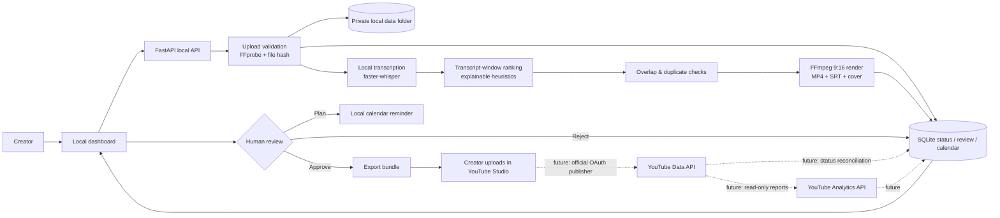

# Clipline system architecture and implementation plan

**Decision date:** 25 October 2026. **Current user constraints:** start fresh, ₹0/month, local computer, YouTube Shorts first, source rights/input method not yet decided. The prototype therefore starts with **one authorized local upload at a time**. It does not fetch platform URLs or connect a social account.

## 1. What is built now

| Area | Prototype behavior | Not yet implemented |
|---|---|---|
| Input | Upload one MP4, MOV, M4V, MKV, WEBM, or AVI; size cap is configurable (default 2 GiB); user must attest rights | Cloud-folder watch, URL import/download, batch ingest, automated rights verification |
| Validation | FFprobe reads duration, dimensions, video/audio streams; rejects unreadable/no-audio files and sources over 8 hours | Perceptual audio-quality checks, malware scanning, content-rights/license validation |
| Transcript | Optional local `faster-whisper` transcription with time-coded segments | Remote API transcription, speaker diarization, transcript editor |
| Highlights | Explainable lexical heuristics rank transcript windows; overlap/text de-duplication; score is only a review aid | Multimodal/LLM context review, scene/speaker-aware boundaries, measured performance model |
| Rendering | FFmpeg 1080×1920 (9:16), H.264/AAC MP4, center crop, cover frame, SRT sidecar; attempts caption burn-in if `libass` exists | Face/speaker tracking, B-roll, transitions/zoom, configurable caption themes, per-platform render presets |
| Metadata | Editable conservative title/caption/hashtag suggestions derived from transcript words | LLM writing, thumbnail generation beyond a cover frame, audience-based time recommendations |
| Review | Dashboard preview plus explicit approve/reject; edit metadata; local pause switch | Multi-user review/roles |
| Calendar | Timezone-aware local reminders, one idempotent YouTube plan per clip | No upload, no actual YouTube scheduling, no retrying publisher |
| Analytics | Shows workflow counts only; leaves performance metrics blank | YouTube Analytics connection, views, watch time, retention, likes/comments/shares |

### Explicitly not claimed

This is a real local processing scaffold, not an end-to-end social publisher. No OAuth credentials were supplied, no YouTube upload was attempted, and there is no successful test publication. A calendar reminder is **not** a scheduled YouTube post. Source permission is a checkbox attestation, not a legal or automated verification. All performance scores are heuristic and do not promise reach or virality.

## 2. System diagram



### Module boundaries

- **UI:** static HTML/CSS/JavaScript; uses relative `/api/...` endpoints and never calls a developer's `localhost` from the browser.
- **API:** `app/main.py` owns upload, review, export, calendar, setup, and pause routes. It exposes no token or absolute file path to the dashboard.
- **Worker:** `app/pipeline.py` sequences media tools; `app/highlights.py` is replaceable selection logic; `app/rendering.py` contains FFmpeg/FFprobe calls.
- **Storage:** SQLite plus `data/uploads`, `data/clips`, and temporary exports. `data/` is excluded from Git; newly created POSIX files use a private process umask. SQLite records status-transition and approval/local-calendar events (the API exposes `/api/events` and per-video history). SQLite/WAL and files are for one local user, not a shared or public deployment.
- **Future adapters:** keep YouTube upload and Analytics clients behind separate interfaces, each with its own OAuth scopes, persistent job state, and tests. Add Instagram, TikTok, or Facebook only after confirming current account/API eligibility and official permissions.

## 3. Recommended stack and alternatives

### Recommended for this user's MVP

| Job | Recommended | Free/low-cost behavior | Trade-off |
|---|---|---|---|
| Video probing/editing | FFmpeg + FFprobe | Local command-line tools; no usage fee or watermark; the render profile is 1080×1920 H.264/AAC | Install binaries; CPU time and disk are the user's; current prototype center-crops |
| Speech-to-text | `faster-whisper` on CPU (`small` default; `base` for a lighter model) | No per-minute API fee; models run on the creator's computer | Model download and disk/RAM use; CPU transcription may be slow; verify language and words manually |
| Highlight ranking | Local transcript heuristics (implemented) | No paid model/API | Less contextual than a strong multimodal model; deliberately not a “virality guarantee” |
| Dashboard/API | FastAPI + static web UI | No hosted app subscription | Single-user prototype; not hardened for public multi-tenant use |
| State | SQLite + local filesystem | No cloud-storage fee | Backups and cleanup are the user's responsibility; not suitable for concurrent teams |
| Publishing | YouTube Studio manual upload/scheduling | Free, no app credentials required | Not automatic; does not update this dashboard's status |
| Orchestration | **Do not add n8n/Make yet** | Python worker already joins the first workflow | A separate orchestrator adds setup and execution limits without making FFmpeg or OAuth free |

### Alternatives checked against official pricing/product pages

Prices are snapshots, not guarantees; confirm the live plan before paying. USD prices exclude taxes, currency conversion, and possible regional variation.

| Option | Free/price & effective processing cost | Watermark / export | Automation / API / publishing | Setup complexity & fit |
|---|---|---|---|---|
| **Clipline local (recommended)** | ₹0/month recurring software; ₹0 AI API per source minute. Hardware, electricity, internet, storage, and your time are not zero-cost. | No vendor watermark; MP4 1080×1920 + SRT; render speed depends on computer | No account/API connection in this MVP. Manual export → YouTube Studio | Medium setup. Best match for ₹0 and local privacy. |
| **OpusClip** | Official plan page lists Free, Starter at **US$15/mo**, Pro at **US$29/mo**, and Business custom. Its help page prices processing at **1 credit per source minute**; Free is listed as 60 processing minutes/month. So a 60-minute source uses about the full Free monthly allowance; Starter's published 150 credits are roughly US$0.10/source-minute if fully used. | Free export is watermarked and the free page limits export availability to 3 days; Free renders up to 1080p. Paid plan removes the watermark (plan/features differ). | Product page lists YouTube/TikTok/Instagram workflows; scheduling and integration entitlements vary by tier. Verify a specific platform and API before relying on it. | Low setup, hosted video/AI. Convenient, but not ₹0 at recurring volume and media is processed by the vendor. |
| **Vizard** | Official pricing lists Free at **US$0 / 60 credits per month**; its plan page equates one credit to one source minute. Creator is shown at **US$29 monthly or US$14.50/mo billed yearly (US$174/year)**, from 600 monthly credits. | Free: 720p export, 10-minute export cap, 1 GB upload cap, 60-minute source limit, 3-day storage, one social account. Creator: no watermark, 4K, any-length export, 100 GB, six accounts. | Scheduling is shown on Creator and above. The plan matrix includes API and rate-limit rows; check the account's current entitlement, allowed destinations, and exact limits before automating. | Low setup; hosted. Free can trial the workflow but is bounded and storage is short-lived. |
| **n8n Community Edition** | Self-hosted Community is free under n8n's Sustainable Use License; infrastructure and maintenance are yours. n8n Cloud Starter is listed at US$20/mo billed annually for 2.5K workflow executions. | Not a video editor; output quality/watermark is controlled by the video tool | Good for webhooks, notifications, and connecting services. A workflow cannot make unsupported social APIs or platform permissions appear. | Medium/high self-host setup. Consider later if workflow orchestration becomes a real need. “Fair-code/source-available” is more accurate than OSI open source for n8n's license. |
| **Make** | Official Free plan: 1,000 credits/month; paid Core shown at US$9/month on annual billing at the page's 10,000-credit view. Each module action uses credits. | Not a video editor; file handling is constrained | Useful for notifications/metadata. Free plan lists two active scenarios, 15-minute minimum schedule interval, 5-minute maximum run, and 5 MB maximum file size—so do not send a long source video through a free scenario. | Low/no-code, but poor fit for heavy media processing. |
| **YouTube Studio / Data API** | Studio has no software subscription for manual upload; Data API is quota-based, not a per-minute clipping service. Current `videos.insert` reference lists 100 calls/day and one unit per upload in its Video Uploads quota bucket; project quotas can differ/change. | You control the exported MP4; Shorts require square or vertical format and currently can be up to 3 minutes for standard channels (review music/copyright rules) | Official Data API upload requires OAuth user authorization; YouTube Analytics requires authorized channel data. No API integration is enabled here. | Manual Studio is easiest. OAuth, channel consent, API compliance, upload state reconciliation, and token storage are required before auto-posting. |

**Why not Make/n8n as the first implementation?** The long-running file processing belongs on the local machine. If useful later, n8n can orchestrate job events/notifications around the worker; keep video bytes on local/object storage rather than pushing them through Make's free 5 MB file ceiling.

## 4. Beginner setup: from source to first clip

### A. Install local prerequisites

1. Install Python 3.11 or newer.
2. Install FFmpeg/FFprobe from the [FFmpeg download page](https://ffmpeg.org/download.html) (or your OS package manager). Confirm both commands work in a new terminal.
3. In the repository root, create and activate a virtual environment, then install:

   ```bash
   python -m venv .venv
   # macOS/Linux
   source .venv/bin/activate
   # Windows PowerShell
   .venv\Scripts\Activate.ps1
   pip install -r requirements.txt
   pip install -r requirements-ai.txt
   ```

4. Optional settings are environment variables, not a checked-in `.env` loader:
   - `CLIPPER_DATA_DIR`: path to a private storage directory (defaults to `./data`).
   - `CLIPPER_MAX_UPLOAD_BYTES`: byte limit (defaults to 2 GiB).
   - `CLIPPER_WHISPER_MODEL`: model name (defaults to `small`; the model is fetched on first run).
   - `CLIPPER_WHISPER_DEVICE` / `CLIPPER_WHISPER_COMPUTE_TYPE`: hardware mode (defaults to CPU / `int8`).

### B. Run and create a local candidate batch

```bash
uvicorn app.main:app --host 127.0.0.1 --port 8000
```

Open `http://127.0.0.1:8000` on the same computer. The sandbox preview uses the forwarded preview URL. Upload an authorized source video, attest permission, set 20–45 seconds or another range up to 180 seconds, and wait for `Ready for review`. The UI shows missing tools instead of reporting a false success.

For a clean test, use a source with clear spoken audio and at least one or two complete thoughts longer than the selected minimum. Results depend on the transcript; the first batch is a prototype, not a guarantee that every long video yields four clips.

### C. Review and publish manually

1. Open each candidate and watch the entire clip, including its start/end. The system cannot verify the surrounding context or whether a hook is misleading.
2. Correct captions/title/hashtags; compare the video to the SRT and source; check faces are not cropped and audio is acceptable.
3. Approve or reject. For a plan, use **Add local calendar reminder**; the UI repeats that this does not publish.
4. Export MP4 + SRT + cover + metadata JSON. Upload with YouTube Studio and choose visibility/time explicitly.
5. Check YouTube's processed video and actual Shorts classification before considering the first test successful.

### Accounts, credentials, and integrations

- **Needed for this prototype:** no Google, n8n, Make, cloud-storage, or AI API account. The user supplies a local computer and an authorized source file.
- **For the planned YouTube publisher:** a Google Cloud project with YouTube Data API v3 enabled; an OAuth client and consent screen; an authorized user signing into the target YouTube channel; a narrow upload scope; a locally stored, protected refresh token; and an explicit privacy/schedule choice. The browser must never request the Google account password. The current code does not read or store any OAuth credentials. The current API docs say `status.publishAt` requires `privacyStatus=private` and can only be set on a never-published video; the insert request can otherwise default to public, so a future adapter must always set visibility explicitly and verify the returned resource.
- **For YouTube Analytics later:** channel-owner/authorized OAuth access and only the read scopes required by the chosen reports. Analytics availability and retention granularity vary by report/video.
- **For any platform:** confirm the account type/eligibility, current official API permission, upload limits, scheduling rules, app review, and supported metadata before building an adapter. Instagram/TikTok/Facebook are not included.

## 5. Cost estimate for the chosen local MVP

| Monthly line item | Expected spend |
|---|---:|
| App, SQLite, FFmpeg, local heuristic selection | ₹0 software license |
| Local transcription | ₹0 API charge; local compute/model download only |
| Cloud AI, storage, scheduler, n8n/Make | ₹0 (not used) |
| Manual YouTube Studio upload | ₹0 software fee |
| Hardware, electricity, internet, backups, user's time | Variable / not estimated |
| Optional future API hosting / model APIs / cloud storage | Not included; obtain current quotes before adding |

**Estimated recurring software total: ₹0/month** for the MVP on a computer the creator already owns. A slower CPU can make processing expensive in time and electricity. Don't treat the $0 API figure as a claim about a creator's whole cost of production.

## 6. Reliability, privacy, and rights

- Uploads use a rights attestation, SHA-256 prevents importing the exact same source twice, and candidate transcript hashes plus overlap checks avoid duplicate candidates.
- Local scheduling has a unique clip/platform idempotency key; pressing schedule again updates the existing reminder rather than creating another. It is not an upload queue.
- Pausing blocks new processing steps; an FFmpeg encode already running finishes its active step before stopping. Resume requeues paused videos.
- FFmpeg/FFprobe/local ASR errors are stored as visible job states. Retry is manual and bounded by the user's action; the app does not retry forever.
- OAuth tokens are not collected. If a publisher is later built, use OS credential storage or an encrypted secret store; never commit client secrets/tokens or log them. Keep the app local/trusted; do not expose this single-user prototype to the public internet.
- The database and source files may contain personal data. Back up the entire `data/` folder only to storage you trust; test restore; delete copies when no longer needed.
- Platform terms, copyright, privacy, music rights, and source consent remain the creator's responsibility. Shorts over one minute can have additional copyright-claim consequences; check current YouTube policy before publishing.

## 7. Quality gates and tests

### Automated tests included

```bash
python -m unittest discover -s tests -v
```

The test suite checks transcript cleaning, clip-duration boundaries, overlap de-duplication, transcript-derived metadata, approval-gated calendar plans, idempotent local scheduling, pause state, and exact transcript deduplication. It does not require a downloaded ASR model or a real video.

### Manual clip-quality test

For one authorized sample, check:

- FFprobe duration, video dimensions, and audio presence are plausible.
- The first and final words are complete; the whole thought has enough context.
- The score label reads as a heuristic, not a promise.
- Every subtitle line matches the audio and appears at the right time; edit an inaccurate transcript before export.
- Output opens as an MP4, is 1080×1920/9:16, has clear audio, a usable cover frame, and an SRT sidecar. Check burn-in on a device where the installed FFmpeg has `libass`.
- No duplicate/near-duplicate clip appears in the same batch; manually inspect thematic duplicates too.
- Title, caption, hashtag, rights, platform, and selected time are truthful and approved.

### Failure and duplicate-prevention test plan

- Upload a file with an unsupported extension, a corrupt video, an audio-less video, a too-large file, and an identical source twice; verify safe rejection/visible error and no duplicate library row.
- Run with FFmpeg/FFprobe missing, then with `faster-whisper` missing: the UI must show setup-needed, retain the upload, and allow a manual retry after installing tools.
- Pause during a multi-step job, resume, and confirm only one clip row exists for each stable source/time window.
- Schedule the same approved clip twice; confirm the same local calendar entry is updated, not cloned; cancel and confirm the clip returns to approved.
- **External publishing is not implemented, so publishing failures have not been tested.** Before enabling it, test an expired/revoked OAuth grant, 401/403, quota exhaustion, 429, 5xx, dropped connection/resumable upload, API timeout after server-side success, and process restart during upload. Persist the provider job/video ID before retry; retry only bounded transient errors with backoff; reconcile status before re-upload; never blindly retry an ambiguous upload; require a human for auth/rights/privacy errors.

## 8. Staged implementation plan

1. **Stage 1 — Local MVP (implemented scaffold):** upload one source; validate; local transcription; ranked candidates; 9:16 render; SRT/metadata; preview/edit/approve/reject; local reminder; export; tests.
2. **Stage 2 — First real manual publication:** creator chooses one clip, uploads via YouTube Studio, checks visibility/classification/audio/captions, and records the resulting YouTube ID/status manually. Do not claim automated publication.
3. **Stage 3 — Official YouTube OAuth adapter:** only after the user creates their Google project and accepts the consent flow. Upload through the official API with resumable transfer; idempotency; scheduled publish only after checking current API rules; store tokens safely; use a disabled-by-default switch; add notifications and failure tests. Start with a private/unlisted test selected by the user, then have the creator verify it.
4. **Stage 4 — Analytics feedback:** add read-only authorized reports; store real metrics with query date and platform video ID; display missing/unsupported metrics as unavailable. Compare actual retention, watch duration, views and engagement by topic/hook/duration; never fabricate predictions.
5. **Stage 5 — Scale and other networks:** durable worker queue (RQ/Celery + Redis or equivalent), private object storage, cleanup/retention policy, authenticated multi-user roles, structured logs/alerts, and separately tested official Meta/TikTok/Facebook adapters. Re-check platform access and account eligibility before each launch.

## 9. Running, maintaining, expanding

- **Run:** activate the Python virtual environment and start `uvicorn app.main:app`. Use `make setup`, `make setup-ai`, `make run`, and `make test` on macOS/Linux.
- **Monitor:** dashboard statuses and server terminal errors. A `needs_setup` state is expected if a local tool is missing. Avoid logging credentials when a future provider is added.
- **Pause:** Settings → Processing controls. Resume there when ready.
- **Back up:** stop the server, copy the whole `data/` directory to a private backup location, and test restoring to a separate `CLIPPER_DATA_DIR`.
- **Manage storage:** generated MP4s and source uploads can be large. Keep backups before manually removing `data/`; the prototype has no deletion UI or retention automation.
- **Expand safely:** keep the provider-independent API, worker, selector, renderer, publisher, and analytics adapters separate. Before replacing a provider, contract-test its transcript timestamps, upload idempotency, error classes, and returned metric names.

## Official platform references

Checked 25 October 2026. Revisit these links before deploying because API permissions, plan limits, policy, and pricing may change.

- [YouTube Shorts duration/aspect ratio and copyright guidance](https://support.google.com/youtube/answer/15424877?hl=en)
- [YouTube Data API `videos.insert` (OAuth scopes, upload constraints, quota)](https://developers.google.com/youtube/data/reference/rest/v3/videos/insert)
- [YouTube OAuth 2.0 authorization](https://developers.google.com/youtube/data/guides/authentication)
- [YouTube video upload and schedule fields (`status.publishAt`)](https://developers.google.com/youtube/v3/docs/videos/update)
- [YouTube Analytics channel reports and audience-retention reports](https://developers.google.com/youtube/analytics/channel_reports)
- [OpusClip official plans](https://www.opus.pro/pricing) and [credit calculation](https://help.opus.pro/docs/article/how-are-credits-consumed)
- [Vizard official pricing and plan comparison](https://vizard.ai/pricing)
- [n8n Community Edition and self-hosting guide](https://docs.n8n.io/choose-how-to-use-n8n/)
- [Make official pricing and plan limits](https://www.make.com/pricing)
